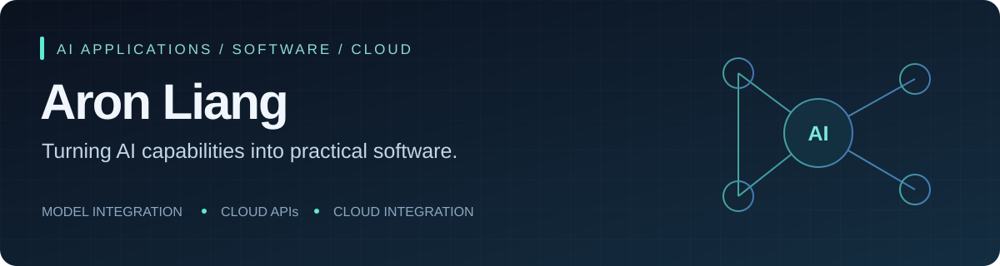

  <a href="#selected-work">Selected work</a> · <a href="#what-i-build">What I build</a> · <a href="#中文简介">中文简介</a>

I build software around **AI capabilities**: connecting inference services, cloud APIs and user interfaces so model outputs become useful product workflows. I also build network lab tools with AI-assisted development, backed by protocol knowledge and repeatable checks.

**My focus:** AI application engineering · Python backend development · cloud integration · network automation.

## Selected work

### 01 / Aussie EcoLens — AI wildlife search

**Computer vision → species tags → searchable media.** A team-built application combining wildlife detection and classification with an AWS + GCP serverless workflow.

**My contribution:** query APIs, the search and result-management frontend, and integration with the team's image/video inference service. This includes multi-tag AND queries, transient-error retries, empty-prediction handling and signed media URLs.

- **AI system:** MegaDetector + PyTorch classification, served through Google Cloud Run.
- **Application:** Python Lambda APIs, DynamoDB, S3, Cognito integration and JavaScript.
- **Evidence:** 21 query/integration unit tests; model inference and live cloud deployment are separate validation steps.
- **Team scope:** model training/inference service, upload infrastructure and authentication setup were shared across teammates; my focus was the application and integration layer.

<!-- ECOLENS_LINK -->

### 02 / NetLab Assist — network automation with AI-assisted development

**Two computers. One operator. Reproducible network checks.** A Python application for TCP throughput, DNS/NAT inspection, multicast, ACL probes and connectivity monitoring.

I use AI-assisted development to turn lab requirements into a usable tool, with explicit protocol behavior, testable outcomes and downloadable Windows/macOS builds. The application itself performs network measurements; it does not contain an AI inference engine.

- **Engineering:** authenticated peer orchestration, multi-NIC routing, proxy-independent peer requests and structured result export.
- **Delivery:** Python standard-library runtime, browser UI, GitHub Actions and PyInstaller packaging.
- **Evidence:** automated tests and the v0.2.0 release for Windows x64, macOS Apple Silicon and macOS Intel.

[Explore source](https://github.com/lzwhirstle/netlab-assist) · [Download v0.2.0](https://github.com/lzwhirstle/netlab-assist/releases/tag/v0.2.0) · [Validation approach](https://github.com/lzwhirstle/netlab-assist/blob/main/docs/VALIDATION.md)

## What I build

| Area | Practical experience |
| :--- | :--- |
| **AI application integration** | Image/video inference APIs, prediction-to-search workflows, timeouts, retries and empty-result handling |
| **Backend & cloud** | Python, REST APIs, AWS Lambda, DynamoDB, S3 and Google Cloud Run integration |
| **Product interfaces** | JavaScript, HTML/CSS, authenticated workflows and result-management screens |
| **Networks & delivery** | TCP/UDP, DNS, NAT, multicast, ACL verification, GitHub Actions and cross-platform packaging |

I care about the full path from a useful idea to software someone can run, inspect and verify.

## 中文简介

你好，我是 **Aron Liang**。我关注 **AI 应用开发与工程落地**：把模型推理、后端 API、云服务和前端交互连接起来，做成能解决具体问题的软件。

- **AI 应用实践：** 在 Aussie EcoLens 团队项目中负责查询 API、前端和推理服务对接，把野生动物识别结果转化为可搜索、可管理的媒体数据。
- **AI 辅助开发：** 结合网络实验需求开发 NetLab Assist，覆盖双端测试编排、协议验证、结果导出和 Windows/macOS 打包交付。
- **关注方向：** AI 应用工程、Python 后端、云服务集成，以及 AI 与网络自动化的结合。

Earlier coursework: <a href="https://github.com/lzwhirstle/comp1531">COMP1531</a> is a historical course-project fork.
